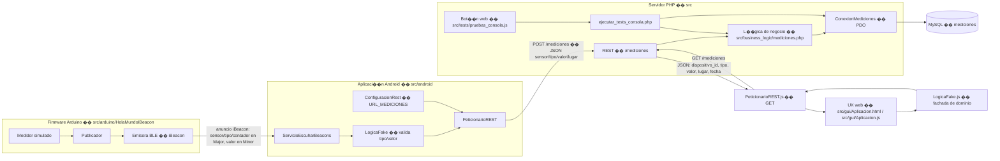

# Proyecto de biometría y medio ambiente

## Objetivo

El proyecto recoge mediciones de CO2 y temperatura. El firmware Arduino prepara y anuncia una medida mediante Bluetooth BLE. La aplicación Android escucha esos anuncios y envía las medidas aceptadas al servidor PHP. El servidor valida los datos y los guarda en MySQL. La página web consulta `GET /mediciones` y representa los valores recibidos.

## Carpetas

| Carpeta | Contenido |
|---|---|
| `src/arduino/HolaMundoIBeacon/` | Sketch Arduino, clases BLE y medidor simulado. |
| `src/android/app` | Proyecto Android: permisos Bluetooth, escucha de beacons, lógica fake, cliente REST y botón para pruebas Android. |
| `src/` | Aplicación web, API REST PHP, lógica de negocio, conexión PDO, SQL y pruebas web/PHP. |
| `doc/` | Diseños y correspondencia entre los diseños y sus archivos de implementación. |
| `author.md` | Autoría del proyecto. |

## Recorrido de una medición

1. Arduino genera una lectura simulada de CO2 o temperatura.
2. `Publicador` codifica el sensor, el tipo y el valor en los campos Major y Minor del anuncio iBeacon.
3. `ServicioEscuharBeacons` en Android analiza el anuncio y extrae sensor, tipo, contador y valor.
4. `LogicaFake` comprueba tipo y valor; `PeticionarioREST` envía `POST /mediciones` con JSON `{"dispositivo_id":"S1","tipo":"CO2","valor":500,"lugar":"Murcia"}`.
5. `src/communication/mediciones.php` valida el método y el cuerpo, delega en la lógica PHP y responde HTTP 201 si se guarda.
6. La web pide `GET /mediciones`. La respuesta es una lista con `dispositivo_id`, `tipo`, `valor`, `lugar` y `fecha`; el servidor genera la fecha.

Los tipos admitidos son `CO2` y `TEMPERATURA`. Los valores deben ser números finitos. La tabla está definida en `src/database/Estructura.sql`.

## Arquitectura completa

El proyecto se organiza en capas. Arduino produce anuncios BLE; Android los consume y actúa como cliente de escritura; el servidor PHP centraliza la validación HTTP, las reglas de negocio y el acceso a MySQL; la web actúa como cliente de consulta y presenta los datos. Arduino y Android se comunican por Bluetooth, Android y el servidor por HTTP, y la página web y el servidor también por HTTP.



### Responsabilidad de cada capa

- Arduino: generar la medida simulada y emitir el beacon iBeacon con sensor, tipo, contador y valor.
- Android: escuchar beacons, validar el tipo/valor, decidir el lugar y enviar mediciones con POST `/mediciones`.
- Servidor PHP: validar el cuerpo HTTP, aplicar las reglas de negocio y guardar/consultar en MySQL.
- Web: solicitar `GET /mediciones` y representar las filas recibidas.

## Mapa de archivos principales

```text
src/arduino/HolaMundoIBeacon/
  HolaMundoIBeacon.ino       Coordinaci?n y ciclo setup/loop
  LED.h / PuertoSerie.h      LED y monitor serie
  Medidor.h                  Medidor simulado
  Publicador.h               Codificaci?n iBeacon y sensor
  EmisoraBLE.h               Publicaci?n BLE
  ServicioEnEmisora.h        Servicio GATT opcional
  test.h                     Prueba BLE por comando "t"

src/android/app/src/main/
  java/.../ServicioEscuharBeacons.java
  java/.../PeticionarioREST.java
  java/.../ConfiguracionRest.java
  java/.../LogicaFake.java
  res/...                    Recursos Android

src/
  communication/mediciones.php  Adaptador GET/POST /mediciones
  business_logic/mediciones.php Validaci?n, inserci?n y consulta
  database/ConexionMediciones.php Selecci?n de configuraci?n y PDO
  database/Estructura.sql      Esquema MySQL
  database/datos.sql           Datos de ejemplo
  database/ConfiguracionProduccion.php Credenciales locales (no versionar)
  frontend_business_logic/PeticionarioREST.js Cliente HTTP web
  frontend_business_logic/LogicaFake.js Fachada de dominio para la UX
  gui/Aplicacion.html / Aplicacion.js Interfaz web
  tests/ejecutar_tests_consola.php Ejecutor web de pruebas PHP/BD
  tests/probar_base_datos.php, probar_rest.php Pruebas PHP aisladas
  tests/pruebas_consola.js Bater?a del navegador
```

## Preparar MySQL y PHP

1. Crea una base de datos MySQL para el proyecto.
2. Ejecuta `src/database/Estructura.sql` sobre esa base. El script crea la tabla `mediciones` con `dispositivo_id`, `fecha`, `tipo`, `valor` y `lugar`.
3. Opcionalmente ejecuta `src/database/datos.sql` para insertar datos de ejemplo.
4. Para desarrollo local, configura PHP con PDO MySQL y sirve la carpeta `src` desde Apache o un servidor PHP compatible. En Apache se usa `.htaccess` para resolver `/mediciones` hacia el endpoint REST.
5. La ruta pública que consumen Android y la web es `/mediciones`: GET consulta y POST guarda.

### Configurar las credenciales de producción

Crea `src/database/ConfiguracionProduccion.php` con esta forma y sustituye los valores de ejemplo:

```php
<?php
return [
    'host' => 'localhost',
    'base' => 'nombre_de_tu_base_de_datos',
    'usuario' => 'usuario_de_mysql',
    'password' => 'contraseña'
];
```

### Despliegue en Plesk

- Sube el contenido de `src/` a `httpdocs`.
- Asegúrate de incluir `.htaccess` en la misma raíz, porque resuelve las peticiones de `/mediciones`.
- Crea `src/database/ConfiguracionProduccion.php` con las credenciales de Plesk.
- Si las variables `MEDICIONES_ENTORNO` no se transmiten, la batería web también puede activarse colocando `MEDICIONES_ENTORNO=pruebas` en `.user.ini` o en la configuración PHP del dominio.

## Web

1. Publica `src/` en el servidor web.
2. Configura PHP y PDO MySQL, la base de datos y `src/database/ConfiguracionProduccion.php`.
3. Abre `src/gui/Aplicacion.html`. La página consulta `/mediciones` para obtener las filas y actualiza su contenido.
4. Para ejecutar las pruebas, pulsa el botón **Ejecutar pruebas** de la página. No se ejecutan al abrirla.
5. Abre las herramientas de desarrollo del navegador y selecciona **Consola**. Allí aparece `EJECUTAR TESTS`, el resultado de cada caso y el bloque `RESULTADOS :` con los grupos y sus recuentos.

El botón ejecuta pruebas del cliente REST web con respuestas simuladas, la fachada de lógica frontend, la presentación de carga/éxito/error, la lógica PHP, el endpoint REST y la conexión/esquema de base de datos. Los grupos de lógica, REST y BD requieren una configuración de base de datos disponible en el entorno.

### Base de datos exclusiva para pruebas web

La batería PHP elimina filas de `mediciones` identificadas como de prueba antes y después de ejecutarse. **No la configures contra una base que contenga datos que quieras conservar** sin revisar las claves `TEST-*`. Crea una base aislada cuando sea posible, aplica `src/database/Estructura.sql` y configura el servidor con:

```text
MEDICIONES_ENTORNO=pruebas
MEDICIONES_DB_HOST_TEST=host_de_pruebas
MEDICIONES_DB_NAME_TEST=nombre_base_de_pruebas
MEDICIONES_DB_USER_TEST=usuario_de_pruebas
MEDICIONES_DB_PASSWORD_TEST=contrasena_de_pruebas
```

En Plesk (PHP-FPM) la batería también puede habilitarse colocando `MEDICIONES_ENTORNO=pruebas` en `.user.ini` o en la configuración PHP del dominio.

También existen `src/tests/probar_base_datos.php` y `src/tests/probar_rest.php` para ejecutar esas comprobaciones PHP por separado desde un entorno que tenga PHP CLI y acceso a MySQL. `src/tests/probar_peticionario_rest.js` y `src/tests/probar_ux.js` contienen casos JavaScript equivalentes a los incluidos en el botón de la web.

## Diseños

Los documentos de diseño están en `doc`:

- [`android_design.md`](doc/android_design.md)
- [`arduino_design.md`](doc/arduino_design.md)
- [`business_logic_design.md`](doc/business_logic_design.md)
- [`communication_design.md`](doc/communication_design.md)
- [`component_map.md`](doc/component_map.md)
- [`database_connection_design.md`](doc/database_connection_design.md)
- [`database_design.md`](doc/database_design.md)
- [`frontend_business_logic_design.md`](doc/frontend_business_logic_design.md)
- [`system_design.md`](doc/system_design.md)
- [`tests_design.md`](doc/tests_design.md)
- [`web_logic_design.md`](doc/web_logic_design.md)
- [`web_rest_client_design.md`](doc/web_rest_client_design.md)
- [`web_rest_design.md`](doc/web_rest_design.md)
- [`web_ux_design.md`](doc/web_ux_design.md)

## Créditos

Autor: Lucía Díaz Murcia  
Repositorio público: https://github.com/LuciaDiazMurcia/Biometria_Medio_Ambiente 